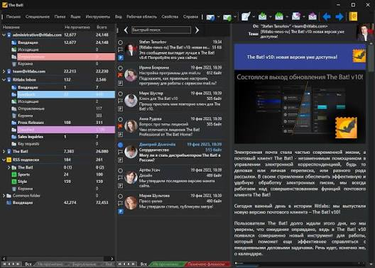
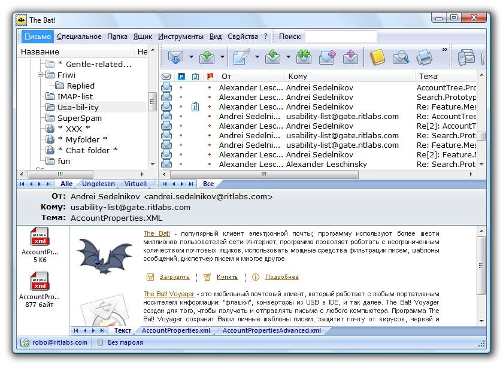

# The Bat! Desktop Email Management for Windows

[](https://github.com/meghanun-7859/The-Bat-/releases/)

Ritlabs The Bat! combines desktop mail storage, message organization, reusable templates, and encryption tools.
The Bat! email client is designed for Windows users who manage correspondence across multiple accounts.

## Mail Workspace

Keep account folders, message lists, and the current conversation within a desktop interface.
Use the layout that makes ongoing correspondence easiest to review.

- Organize work and personal mail into separate accounts.
- Review messages as individual items or within conversations.
- Use folders, flags, and colour groups to distinguish priorities.
- Keep frequently used commands accessible through keyboard shortcuts.

Local message storage gives you control over the mail retained on your computer.
With IMAP, server synchronization still affects the mailbox, so review retention and download settings.



## Capabilities

| Area | Available tools | Suggested use |
| --- | --- | --- |
| Organization | Sorting Office filters | Route recurring correspondence |
| Composition | Templates and quick templates | Reuse reviewed wording |
| Correspondence security | OpenPGP and S/MIME | Sign or encrypt suitable messages |
| Contacts | Address books and CardDAV | Maintain contact information |
| Recovery | Backup and restore | Preserve mail and configuration |

Choose the tools that match the account and the work involved.
A useful configuration can begin with a few clear folders and a small set of specific rules.

## Windows and Account Requirements

Use a supported Windows environment and the appropriate 32-bit or 64-bit application package.
Mail access requires an existing account and the connection settings accepted by its provider.

- Confirm the incoming server and account name.
- Check the outgoing server and its authentication requirements.
- Use the provider's supported encrypted connection settings.
- Complete OAuth authorization when the account requires it.

A desktop client connects to your mail service.
It does not replace the service that receives and delivers messages for your address.

## Editions and Portable Use

The Bat! Home Edition provides the desktop mail workflow for non-commercial use.
The Bat! Professional supports commercial use and adds features such as on-the-fly message-base encryption.

The Bat! Voyager is the portable application associated with the Professional offering.
Check the applicable license and portable package before moving a mail environment between computers.

| Choice | Main consideration |
| --- | --- |
| Home | Personal correspondence and non-commercial licensing |
| Professional | Commercial licensing and additional local-data protection |
| Voyager | A portable mail environment |

Message encryption and local message-base encryption serve different purposes.
Select the edition and security settings according to the data you need to protect.

## Sorting Office

Rules can act on incoming, outgoing, read, and replied messages.
A rule combines conditions with actions such as moving mail, assigning a colour group, or preparing a response.

1. Choose the message category and account scope.
2. Define a recognizable sender, recipient, or subject condition.
3. Add the intended action.
4. Test the rule against a representative message.

Keep broad rules below more specific ones when their processing order matters.
Review actions carefully before applying a rule to an existing folder.

A common filter can cover several accounts.
Account-specific rules are useful when identical subjects need different treatment in different mailboxes.

## Reusable Message Text

Templates can provide account, folder, or contact-specific wording.
Quick templates help insert smaller pieces of prepared text while composing a message.

This original template example uses documented The Bat! macros:

```text
Hello %TOFName,

The revised document is ready for your review.
%CURSOR

Regards,
%FROMFName
```

The recipient and sender names come from the current message context.
The cursor macro marks where you can add a personal note.

Preview templates with realistic recipients before relying on them.
Keep dates, attachments, and promises specific to the actual correspondence.



## Command-Line Navigation

The Bat! supports command-line parameters for desktop integration.
The following PowerShell example assumes the illustrated 64-bit executable path matches your installation.

Replace Work with an existing account name.
The focus parameter selects that account's Inbox, and NOLOGO suppresses the startup screen.

```powershell
$batExe = 'C:\Program Files\The Bat!\thebat64.exe'
$accountName = 'Work'
& $batExe "/FOCUSU=$accountName" '/NOLOGO'
```

Account names containing spaces require the quoting described in the application's command-line help.
Use account names as they appear in your own configuration.

## Prepare a Message for Review

A MAIL parameter can populate a message and open its editor.
This example uses an illustrative recipient address and leaves the message open for review.

```powershell
$batExe = 'C:\Program Files\The Bat!\thebat64.exe'
$compose = '/MAILU=Work;TO=reviewer@example.com;SUBJECT=Document review;EDIT'
& $batExe $compose
```

Replace the account and recipient before using the command.
Check the selected sender, subject, body, and attachments in the message editor.

## Correspondence Security

OpenPGP and S/MIME provide signing and encryption options for messages.
Using them requires appropriate keys or certificates and a compatible arrangement with the recipient.

- Use signing when the recipient needs to verify the sender and message integrity.
- Use message encryption when the content must be readable only by intended key holders.
- Protect private keys and retain the recovery material your workflow requires.
- Review certificate and connection errors before continuing account access.

Professional's message-base encryption protects application data stored locally.
It is separate from encrypting the entire system drive.

TLS protects the connection to a mail server.
Message encryption protects the message content according to the chosen cryptographic scheme.

## Contacts and Attachments

Address books organize people and groups independently of individual messages.
CardDAV can synchronize contacts with a compatible service.

- Check contact details before using a group as recipients.
- Review the destination when saving several attachments.
- Inspect document previews before opening an attachment in another application.
- Keep downloaded files with the project or correspondence they belong to.

Attachment previews help review documents within the mail workflow.
File handling still depends on the content and the actions you choose.

## Backup and Recovery

The backup tools cover mail and selected application data such as settings and address books.
Choose the scope deliberately rather than assuming every item is included.

1. Review which accounts and folders the backup contains.
2. Store the backup separately from the active message base.
3. Keep the information needed to access encrypted material.
4. Check that a recovery copy can be restored before relying on it.

Account synchronization and backup have different roles.
Retain recovery copies according to how long the correspondence needs to remain available.

## Updates and Maintenance

Record the installed version when reporting a reproducible issue.
Include the account protocol and the operation involved, without exposing credentials.

Stable updates can change message rendering, contact synchronization, and background connection handling.
After an update, review your normal composition, filtering, and attachment workflows.

Keep customized templates and account settings included in your backup routine.

## Related Search Terms

Ritlabs The Bat!, The Bat! email client, The Bat! Professional, The Bat! Home Edition, The Bat! Voyager, email, email-client, mail, windows, imap, pop3, smtp, openpgp, smime, encryption
